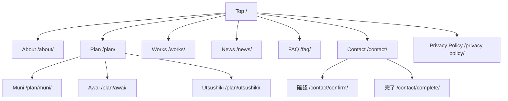

# サイトマップ

[docs/project/README.md](./README.md) から参照される、サイト構造の一覧。ページの追加、リンク作成、URL・スラッグを確認するときに読む。

**ページ・投稿タイプ・タクソノミーを変更したら、同じコミットでこのファイルを更新する。**

## 全体構造　例

## ページ一覧

- **種別**: `フロント` / `固定ページ` / `CPTアーカイブ` / `CPTシングル` / `タクソノミーアーカイブ`
- **テンプレート**: 固定ページは `src/pages/page-*.php` の `Template Name` を管理画面で選んで適用する（スラッグでは自動で決まらない）。

| ページ名         | URL                          | スラッグ         | 種別                   | 親        | テンプレート                      |
| ---------------- | ---------------------------- | ---------------- | ---------------------- | --------- | --------------------------------- |
| Top              | `/`                          | -                | フロント               | -         | `front-page.php`                  |
| About            | `/about/`                    | `about`          | 固定ページ             | -         | `pages/page-about.php`            |
| Plan             | `/plan/`                     | `plan`           | 固定ページ             | -         | `pages/page-plan.php`             |
| Muni             | `/plan/muni/`                | `muni`           | 固定ページ             | Plan      | `pages/page-plan-muni.php`        |
| Awai             | `/plan/awai/`                | `awai`           | 固定ページ             | Plan      | `pages/page-plan-awai.php`        |
| Utsushiki        | `/plan/utsushiki/`           | `utsushiki`      | 固定ページ             | Plan      | `pages/page-plan-utsushiki.php`   |
| Works一覧        | `/works/`                    | -                | CPTアーカイブ          | -         | `archive-works.php`               |
| Works詳細        | `/works/{post-slug}/`        | -                | CPTシングル            | Works一覧 | `single-works.php`                |
| News一覧         | `/news/`                     | -                | CPTアーカイブ          | -         | `archive-news.php`                |
| News詳細         | `/news/{post-slug}/`         | -                | CPTシングル            | News一覧  | `single-news.php`                 |
| Newsカテゴリー   | `/news/newscat/{term-slug}/` | -                | タクソノミーアーカイブ | News一覧  | `archive-news.php`                |
| FAQ              | `/faq/`                      | `faq`            | 固定ページ             | -         | -                                 |
| Contact          | `/contact/`                  | `contact`        | 固定ページ             | -         | `pages/page-contact.php`          |
| お問い合わせ確認 | `/contact/confirm/`          | `confirm`        | 固定ページ             | Contact   | `pages/page-contact-confirm.php`  |
| お問い合わせ完了 | `/contact/complete/`         | `complete`       | 固定ページ             | Contact   | `pages/page-contact-complete.php` |
| Privacy Policy   | `/privacy-policy/`           | `privacy-policy` | 固定ページ             | -         | `pages/page-privacy.php`          |
| UIコンポーネント | `/components/`               | `components`     | 固定ページ             | -         | `pages/page-components.php`       |

## カスタム投稿タイプ

登録: `src/functions/register_post_taxonomy.php`

| post_type | 名称  | アーカイブURL | タクソノミー                                                              | 内容     |
| --------- | ----- | ------------- | ------------------------------------------------------------------------- | -------- |
| `news`    | News  | `/news/`      | `newscat`                                                                 | お知らせ |
| `works`   | Works | `/works/`     | `works_plan`, `works_area`, `works_guests`, `works_season`, `works_venue` | 施工事例 |

## カスタムタクソノミー

| taxonomy       | 名称       | 対象    | 階層 | URL                          |
| -------------- | ---------- | ------- | ---- | ---------------------------- |
| `newscat`      | カテゴリー | `news`  | あり | `/news/newscat/{term-slug}/` |
| `works_plan`   | プラン     | `works` | あり | -                            |
| `works_area`   | エリア     | `works` | あり | -                            |
| `works_guests` | 人数       | `works` | あり | -                            |
| `works_season` | 季節       | `works` | あり | -                            |
| `works_venue`  | 会場       | `works` | あり | -                            |

- `works_*` はWorks一覧の絞り込み用。`rewrite => false` のためタームアーカイブのURLは生成せず、`/works/?works_area=tokyo,osaka` のようにクエリパラメータで絞り込む。
- 一覧ページのフィルターの表示順は `works_taxonomies()`（`src/functions/register_post_taxonomy.php`）の並び順。

### ターム

| taxonomy  | ターム名 | スラッグ |
| --------- | -------- | -------- |
| `newscat` | お知らせ | news     |
| `newscat` | イベント | event    |
| `newscat` | レポート | report   |

`works_*` のタームは未登録。管理画面で追加したらここに追記する。
